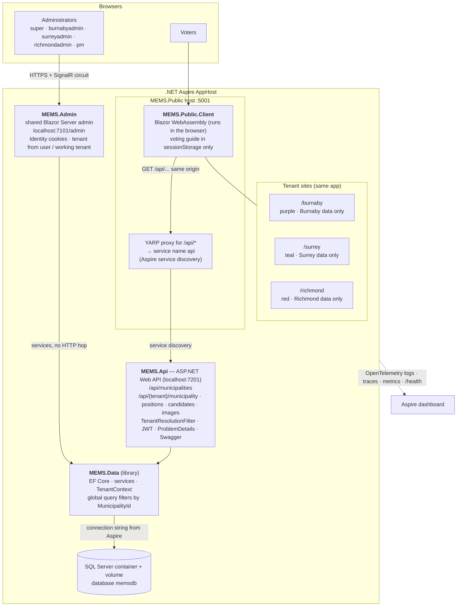
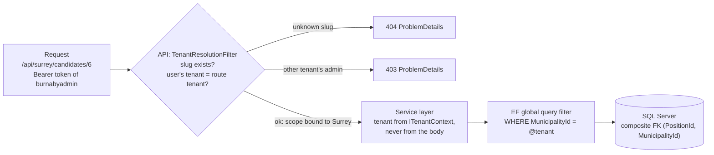

# System architecture

MEMS is one multi-tenant system: every municipality is a **tenant** identified by a URL slug. Adding a
municipality is a data change made in the admin site — no new application, project or deployment.

**Why `MEMS.Public.Client` is a separate project:** WebAssembly code must be compiled into its own
Blazor WebAssembly project; `MEMS.Public` is the ASP.NET Core host that serves it and proxies `/api/*` to
the API, because a browser cannot resolve Aspire service-discovery names.

## Tenant isolation (enforced three times)

| Layer | Mechanism | What it prevents |
|---|---|---|
| Blazor Server admin | `AdminTenantResolver`: Municipality Admin fixed to the `municipality_id` claim; Super Admin "All" or a working tenant (claim in the cookie). Re-validated every minute. | A Municipality Admin seeing or editing another tenant in any list, dropdown, dashboard, URL or image. |
| Web API | `TenantResolutionFilter` binds every `/api/{tenant}/...` request to the route tenant; other-tenant admin tokens get 403; JWT security-stamp check. | Changing the URL or request body to reach another tenant. |
| EF Core | `TenantContext` (scoped, set once, fail closed) read by global query filters; `IDbContextFactory` registered **scoped** so each context gets the tenant of its own request/circuit. | A forgotten `Where` clause leaking rows; tenants mixed between users. |
| Database | Unique slug, composite FK `Candidate(PositionId, MunicipalityId) → Position(Id, MunicipalityId)`, check constraints. | Inconsistent rows even if application code is wrong. |

## Request paths

| Who | Path |
|---|---|
| Voter | Browser → MEMS.Public (static WASM files) → WASM app → `GET /api/{tenant}/...` → YARP → MEMS.Api → MEMS.Data → SQL Server |
| Administrator | Browser → MEMS.Admin (Blazor Server circuit) → MEMS.Data services → SQL Server |
| Other clients | → MEMS.Api with JWT from `POST /api/auth/login` |

## Election privacy

Voting-guide selections never leave the voter's browser: they are kept in `sessionStorage` (ids only),
the WebAssembly API client has GET methods only, and the database has no table for selections or totals.
The E2E check `tests/e2e/public-e2e.mjs` records every network request to prove it.

## Aspire

| Resource | Type | References / waits for | Health check |
|---|---|---|---|
| `sql` | SQL Server container, volume `mems-sql-data`, persistent | — | SQL connection |
| `memsdb` | database | `sql` | database connection |
| `api` | MEMS.Api | `memsdb` (WaitFor), parameter `jwt-key` | `/health` |
| `admin` | MEMS.Admin | `memsdb`, waits for `api` (migrations + seed done) | `/health` |
| `public` | MEMS.Public | `api` (service discovery) | `/health` |

`MEMS.ServiceDefaults` adds OpenTelemetry (logs, traces incl. EF Core/SQL and HTTP, metrics), `/health`
and `/alive`, service discovery and HTTP resilience to every project.
