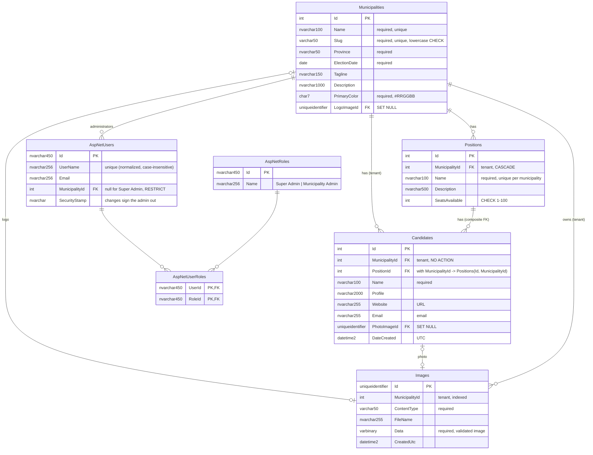

# Entity relationship diagram

Generated from the EF Core model (`MEMS.Data/MemsDbContext.cs`, migration `InitialCreate`) on SQL Server.
Identity tables not used directly (claims, logins, tokens, role claims) are omitted.

## Notes

- **Tenant relationship** (spec "Tenant Data Model"): `Position`, `Candidate`, `Images` and administrator
  accounts (`AspNetUsers`) carry `MunicipalityId`. A Municipality Admin has exactly one tenant; a Super Admin has none.
- `Candidates.MunicipalityId` duplicates the position's tenant on purpose: it allows a row-level query filter
  on candidates, and the composite foreign key guarantees it always equals the position's tenant.
- Images are stored in SQL Server so the Admin app and the API (and therefore the public site) share them;
  the API serves them at `/api/{tenant}/images/{id}`.
- Deleting a tenant is done by `MunicipalityService.DeleteAsync` in one transaction: candidates, positions,
  images, administrator accounts, then the municipality.
- Changes since Assignment 1: SQLite → SQL Server; `Slug`, `Tagline`, `PrimaryColor` added; per-municipality
  admin roles replaced by `AspNetUsers.MunicipalityId` + two roles; logo/photo files → `Images` table;
  `SavedCandidates` table **removed** (election privacy).
- There is no table for voting-guide selections, ballots or vote totals.
