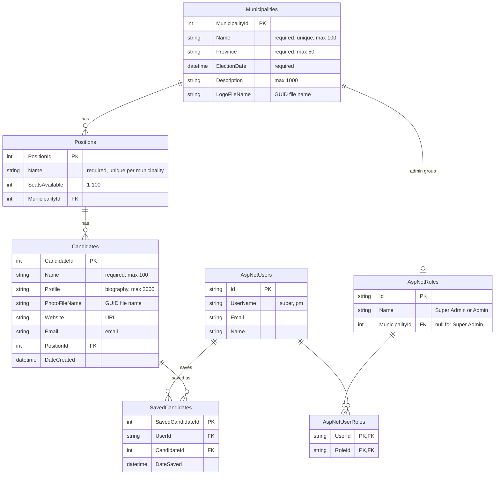

# Entity Relationship Diagram

Generated from the EF Core model (`MunicipalElections/Data/ApplicationDbContext.cs`, migration
`InitialCreate`). Identity tables that are not used directly (claims, logins, tokens) are omitted.

## Relationships and rules
| Relationship | Type | On delete |
|---|---|---|
| Municipality → Positions | one-to-many | cascade |
| Position → Candidates | one-to-many | cascade |
| Municipality → admin group (`AspNetRoles.MunicipalityId`) | one-to-zero-or-one | cascade |
| User ↔ Role (`AspNetUserRoles`) | many-to-many | cascade |
| User / Candidate → SavedCandidates (REST API voting guide) | one-to-many | cascade |

- A candidate's municipality is derived from its position (`Candidate → Position → Municipality`),
  so it is stored once.
- A municipality admin may manage only the municipality linked to their admin group; the
  `Super Admin` group has no municipality and manages everything.
- The public website's voting guide is stored in session state, not in the database.
